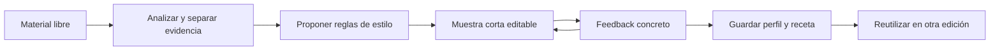

# HyperFrames, estilos personales y onboarding de Syka

## Decisión posterior que reemplaza partes de esta propuesta

Sikora confirmó edición/render nativos en Diffusion. Se descarta la Etapa E de renderizar con HyperFrames e importar el MP4. Sus contratos y métodos se adaptan al motor actual. Las recetas para reels/YouTube/marca viven dentro de Biblioteca y en el proyecto, sin una pantalla separada de perfiles. El onboarding completo sigue postergado. Las secciones históricas de perfiles/renderer opcional más abajo son propuestas anteriores, no el rumbo aprobado.

Primer avance implementado: receta persistente de proyecto con revisiones/backups, categorías de recetas en Biblioteca, bases nativas de recursos, explicación visual e importación de diseños aportados, y refuerzo de recuts/captions. No equivale a importar todo el registry ni a ejecutar los 21 workflows upstream. Ver `NATIVE_WORKFLOWS_AND_PREVIEW_2026-10-04.md` para el alcance y las pruebas.

Fecha: 4 de octubre de 2026. Estado: investigación y propuesta de implementación. No se cambió el motor ni se instalaron nuevas skills en esta entrega. El onboarding completo se trabajará después, según la última aclaración de Sikora.

## Dirección acordada

El onboarding será una conversación libre. Una persona puede aportar una marca completa, videos que quiere recrear, imágenes, tipografías, logos, preferencias escritas o combinaciones de esos materiales. Syka recomienda qué falta, analiza lo disponible y hace preguntas concretas sobre resultados visibles. Se permiten varios perfiles de estilo, con uno predeterminado. No se obliga a completar un formulario ni a terminar un perfil para editar.

La mejora buscada es que el agente tenga decisiones y ejemplos suficientes para producir un resultado consistente. No se entrenan los pesos de Codex ni se entrena HyperFrames. Se construye conocimiento reutilizable: instrucciones, datos de estilo, componentes ejecutables, evidencia visual y versiones aprobadas.

## Qué se investigó y qué se comprobó

- Snapshot público de `heygen-com/hyperframes` en el commit `107d4d980c7194c31954468db16aac64e4f4f549`.
- Inventario completo del manifiesto de skills: **21** entradas publicadas.
- Inventario completo del registry: **394** entradas; **164 bloques, 222 componentes y 8 ejemplos**. Este número es del manifiesto leído, no un número fijo del producto.
- Contratos y referencias prioritarias de dirección, animación, composición, revisión, memoria/recetas, medios y workflows. Se descargaron las 21 entradas SKILL.md para la auditoría; no se ejecutaron sus workflows.
- Inspección de código y metadatos de seis familias: flowchart, liquid-glass-notification, transitions-blur, caption-editorial-emphasis, chart-story y logo-sting. No se reprodujeron ni se evaluaron visualmente las 394 previews.
- Comparación de las entradas instaladas en las raíces globales de Codex/Agents con ese snapshot. Hay **10 de las 21** en la raíz de Codex; no hay una segunda copia de esas entradas en la raíz global Agents. Nueve entradas difieren del snapshot remoto; esto prueba diferencia de contenido, no incompatibilidad ni una prueba completa de frescura del bundle.
- npm declara **0.8.124** como `latest` en la consulta. El laboratorio Claudio mantiene **0.8.43** fijado. No se actualizó: su resultado aceptado debe conservarse reproducible.
- Lectura del código actual de Syka: instrucciones del agente, almacenamiento de skills, herramientas de recursos, guía Watch, HTML y surface del motor y variables `@inspect`.
- Consulta de documentación oficial de Descript, OpusClip, CapCut y Runway. Las funciones documentadas no se probaron en sus aplicaciones ni cuentas.

Las fuentes remotas obtenidas se conservaron temporalmente fuera del repositorio. Los datos públicos relevantes se sintetizan aquí. La edición Liquid previa sigue aislada; esta investigación no la convierte en integración nativa.

Fuentes de inventario: [manifiesto de skills](https://github.com/heygen-com/hyperframes/blob/107d4d980c7194c31954468db16aac64e4f4f549/skills-manifest.json), [manifiesto del catálogo](https://github.com/heygen-com/hyperframes/blob/107d4d980c7194c31954468db16aac64e4f4f549/registry/registry.json), [paquete publicado](https://www.npmjs.com/package/hyperframes).

## Cómo funciona HyperFrames

HyperFrames convierte HTML, CSS, medios y animaciones controlables por tiempo en video. El agente escribe el proyecto; HyperFrames interpreta su estructura, posiciona medios, busca el estado de cada cuadro en Chrome y produce el archivo con su pipeline de captura/encode/mezcla. No es un modelo que inventa video por sí mismo.

Hay tres capas útiles para Syka:

1. **Dirección y proceso:** brief, `frame.md`, storyboard, revisión y recetas reutilizables.
2. **Diseños y movimiento:** componentes de catálogo, reglas pequeñas combinables, blueprints de escenas, animaciones de tipografía, cámaras y transiciones.
3. **Runtime y render:** atributos `data-*`, timelines registradas, gestión de medios, captura en Chrome y render local o servicios opcionales.

Las primeras dos capas aportan método y código adaptable. La tercera tiene un contrato distinto al motor de Syka. Instalar la skill enseña al agente ese contrato; no instala por sí sola cada runtime, proveedor, catálogo externo ni dependencia, ni hace compatible un proyecto HyperFrames con Diffusion.

La animación debe depender del tiempo de la composición. Si se pide el segundo 2.5, debe verse el mismo cuadro después de avanzar, retroceder, recargar o exportar. Eso permite que una máquina lenta renderice correctamente sin depender de reproducir la animación en tiempo real.

Fuentes: [introducción oficial](https://hyperframes.heygen.com/introduction), [contrato core](https://github.com/heygen-com/hyperframes/blob/main/skills/hyperframes-core/SKILL.md), [paquetes del framework](https://github.com/heygen-com/hyperframes#packages).

## Qué aporta a la calidad

### Diseño para video

`hyperframes-creative` separa la marca del layout. Conserva colores, fuentes y relaciones de peso, pero adapta tamaños, márgenes, bordes y contraste al tamaño de reproducción. Una tarjeta de web con letras de 14 px y sombra mínima puede verse elegante en el monitor y perderse al compartir el video.

`frame.md` expresa tokens verificables y contexto creativo. La especificación de marca no decide que todos los cuadros deban ser tarjetas iguales. El storyboard decide qué mostrar: una frase, una comparación, una secuencia de pasos, evidencia de interfaz o una pausa sin gráficos.

Fuente: [design-spec](https://github.com/heygen-com/hyperframes/blob/main/skills/hyperframes-creative/references/design-spec.md), [video-composition](https://github.com/heygen-com/hyperframes/blob/main/skills/hyperframes-creative/references/video-composition.md).

### Movimiento con una función

La skill de animación reúne reglas pequeñas, blueprints, transiciones y adapters para GSAP, Anime.js, Lottie, Three.js, CSS, WAAPI y TypeGPU. Conviene elegir unas pocas reglas que sostengan la información: revelar una relación, dirigir la mirada, conectar dos estados o dar peso a una llegada. No sumarlas todas a cada cuadro.

El catálogo incluye piezas ejecutables, no sólo nombres de efectos. Por ejemplo, `chart-story` declara datos, etiquetas, un valor a destacar y un punto de sincronización; `logo-sting` declara una llegada y su impacto. Esa estructura sirve para coordinar sonido y contenido sin improvisar cada animación desde cero. Su ejemplo de wordmark no sustituye un SVG real cuando se necesita la marca original.

Fuente: [animation](https://github.com/heygen-com/hyperframes/blob/main/skills/hyperframes-animation/SKILL.md), [chart-story](https://github.com/heygen-com/hyperframes/blob/main/registry/components/chart-story/registry-item.json), [logo-sting](https://github.com/heygen-com/hyperframes/blob/main/registry/components/logo-sting/registry-item.json).

### Memoria basada en resultados

HyperFrames distingue preferencias de recetas congeladas. Una receta conserva diseño, estructura de storyboard y decisiones de un resultado aprobado; versiona el paquete para volver a usarlo. Éste es un patrón muy valioso para Syka: guardar aquello que dio un buen resultado, con instrucciones suficientes para repetirlo con contenido nuevo.

No copiaría literalmente su regla de promover preferencias tras dos proyectos. En Syka una persona puede definir un default explícitamente desde el primer día; un cambio puntual debe seguir siendo puntual hasta que quiera incorporarlo a su perfil.

Fuente: [preferencias y recetas](https://github.com/heygen-com/hyperframes/blob/main/skills/media-use/references/memory.md).

### Revisión visible

Su proceso distingue plan, layout, movimiento y entrega. Syka debe heredar la separación, adaptando las pausas al pedido: si la persona autorizó editar y exportar, se completa ese trabajo; no se inventa una autorización adicional en cada fase. Para una referencia ambigua, una muestra corta puede resolver la decisión antes de procesar un video largo.

Fuente: [review-loop](https://github.com/heygen-com/hyperframes/blob/main/skills/hyperframes/references/review-loop.md).

## Las 21 skills y su encaje

“Instalada” significa disponible en Codex global, no incluida ni ejecutada dentro de Syka. La aplicación conserva sus nueve bases propias.

| Skill oficial | Codex global | Uso recomendado en Syka |
| --- | --- | --- |
| hyperframes | Sí | Tomar selección de workflow y brief; conservar el routing propio del editor. |
| hyperframes-core | Sí | Estudiar contratos; traducir a Diffusion, no inyectar atributos HF esperando que funcionen. |
| hyperframes-animation | Sí | Reglas, blueprints y continuidad para mejorar motion y transiciones. |
| hyperframes-keyframes | Sí | Movimiento determinista y análisis de desplazamientos/cámaras. |
| hyperframes-creative | Sí | Diseño por cuadro, jerarquía, tipografía, ritmo y comprobación del estilo. |
| hyperframes-registry | Sí | Buscar diseños reales y construir una selección adaptada con previews. |
| hyperframes-audio | Sí | Mezcla, ducking, carve, automatización y buses; traducir a operaciones compatibles. |
| general-video | Sí | Proceso de edición general y conversaciones sobre piezas existentes. |
| motion-graphics | Sí | Unidades cortas de motion, logos, cifras, diagramas y callouts. |
| product-launch-video | Sí | Storyboard de lanzamiento y evidencia visual del producto. |
| **hyperframes-cli** | **No** | Prioridad alta para el laboratorio opcional: check/snapshot/compare/render y diagnósticos. Sus comandos no validan una composición Diffusion. |
| **hyperframes-studio** | **No** | Prioridad alta como referencia de organización: pistas legibles, tipos de elemento y zonas seguras. No sustituir la UI de Syka por Studio. |
| **media-use** | **No** | Prioridad alta: resolver/reutilizar medios, procedencia y recetas. Adaptar primero a recursos locales y proveedores ya configurados. |
| **talking-head-recut** | **No** | Prioridad alta para explicaciones con gráficos apoyados en lo que se dice. Adaptar a `syka-explainer-edit`; no copiar defaults ni el workflow entero. |
| **embedded-captions** | **No** | Prioridad alta/media: identidades tipográficas y revisión de captions. Segmentar sujetos requiere otro pipeline; empezar por captions nativos. |
| **music-to-video** | **No** | Prioridad media: ritmo por frases/energía/beats; útil en piezas impulsadas por música. |
| **faceless-explainer** | **No** | Prioridad media: diagramas y tipografía para explicar sin footage. |
| **figma** | **No** | Opcional: importar marca, assets y estados diseñados con autenticación propia. No equivale a importar un video como capas. |
| **pr-to-video** | **No** | Opcional: presentar cambios del editor desde un diff; poca prioridad para edición cotidiana. |
| **slideshow** | **No** | Baja prioridad: su salida es un deck navegable. Su contrato actual no admite asumir un render lineal completo a MP4. |
| **remotion-to-hyperframes** | **No** | Baja prioridad: port explícito Remotion → HF. No es un conversor HF → Diffusion ni un adaptador genérico. |

Fuente: [guía de instalación](https://github.com/heygen-com/hyperframes/blob/main/docs/guides/skills.mdx) y entradas individuales bajo [skills](https://github.com/heygen-com/hyperframes/tree/main/skills). No se propone cargar las 21 completas en cada conversación. Las referencias se consultan según la tarea.

Hay diez bases/domain skills en el conjunto core y once rutas/workflows en el catálogo auditado. La instalación local tiene siete del conjunto core y tres workflows. Lo útil es completar o actualizar una selección fijada para el laboratorio y adaptar conocimientos concretos al editor; no cambiar silenciosamente todas las instalaciones globales.

## Lo que no conviene heredar automáticamente

- `talking-head-recut` conserva el clip debajo de los overlays; su nombre no prueba que haga el montaje que necesitamos.
- Su receta fija un piso de cinco tarjetas. Eso puede sobrecargar una prueba de once segundos. En Syka la cantidad depende de la información, el tiempo de lectura y la preferencia de la persona.
- Su ejemplo de transcripción usa `small.en`. Para español se conserva el proveedor/transcript correcto de Syka, sin adoptar un modelo inglés por copiar el comando.
- `classic`, noir, warm-paper o cualquier preset son opciones. Ninguno se convierte en estilo fijo de la aplicación.
- Las recomendaciones de densidad, movimiento ambiental y tipografía de sus guías no deben convertirse en prohibiciones universales. Un plano quieto o una tarjeta mínima pueden ser la decisión correcta.
- `media-use` combina archivos locales con servicios opcionales. Su catálogo, TTS o generación pueden requerir una cuenta/proveedor; instalar instrucciones no habilita ni financia esos servicios. `hyperframes-audio` mezcla audio ya colocado; no genera música por sí sola.

Fuentes: [talking-head-recut](https://github.com/heygen-com/hyperframes/blob/main/skills/talking-head-recut/SKILL.md), [media-use](https://github.com/heygen-com/hyperframes/blob/main/skills/media-use/SKILL.md), [audio](https://github.com/heygen-com/hyperframes/blob/main/skills/hyperframes-audio/SKILL.md).

## Adaptación al motor Diffusion

### Ruta principal: componentes nativos

Mantener video/audio/captions/textos/logos como elementos del motor. Para tarjetas y layouts complejos, usar `<html>` con una timeline pausada gobernada por `useTicker`. La implementación actual recomienda Anime.js; GSAP requeriría la dependencia correspondiente y pruebas de lifecycle/export, no se asume incluido.

Las escenas editoriales de un storyboard son secuencias o grupos dentro de la composición activa. No convertir cada scene de HF en una nueva `<scene>` de Syka: en nuestro editor son composiciones diferentes, y el agente ya está instruido a no crearlas para una edición ordinaria sin pedido explícito.

Correspondencias que debe resolver cada adapter:

| HyperFrames | Diffusion/Syka |
| --- | --- |
| `data-start`, `data-duration`, media start | Inicio/fin, trim y secuencias nativas; distinguir reloj de fuente y timeline. |
| Una timeline pausada buscada por tiempo | Ticker del motor y tiempo local del componente; tests de avance y retroceso. |
| `<video>`/`<audio>` en el documento | Elementos de composición fuera del host HTML. |
| Bloque/template y variables HF | Componente TSX + configuración; controles `@inspect` cuando correspondan. |
| Canvas/WebGL dentro del documento | `<surface>` con renderer propio y reloj del motor; prueba de export obligatoria. |
| Captions word array HF | Normalización del transcript real de Syka sin inventar intervalos. |
| Un track por clase de elemento | Pistas/grupos nombrados para que se pueda editar; sin imponer exactamente las convenciones de Studio. |

`@inspect` actualmente expone constantes a nivel de stage; no promete por sí mismo controles por clip ni hace que cada hijo de un `<html>` se seleccione como una capa nativa. Para texto, logo o geometría que la persona quiera manipular directamente, preferir nodos nativos. Un gráfico HTML complejo puede ser editable por parámetros y código; esa diferencia debe mostrarse en la biblioteca.

Fuentes del motor: [html](reference/jsx/html.md), [surface](reference/jsx/surface-paint.md), [variables](reference/jsx/variables.md). Wiring del agente: `packages/agent-chat/src/host/editorial-instructions.ts` y `codex.ts`.

### Prototipos específicos

- **Flowchart:** HTML + SVG + timeline; candidato razonable para adapter de diagrama, todavía sin prueba nativa de este bloque exacto.
- **Chart Story:** datos/labels/énfasis y estados temporales; candidato a gráficos nativos con valores exactos.
- **Editorial captions:** adaptar la identidad al renderer de captions/texto, conservando sus tiempos y posibilidad de edición.
- **Blur transitions:** trasladar efectos simples a las primitivas nativas y probar cuadros intermedios, no sólo el hold.
- **Liquid Glass Notification:** el código auditado combina canvas, renderer 3D, librería LiquidGlass y rutas GPU/paint; está marcado experimental. Es más complejo que pegar `backdrop-filter`. Hay que definir de dónde obtiene los píxeles de fondo en el compositor nativo antes de prometer refracción sobre footage.

El host HTML tiene límites conocidos de captura en scale/clipping y opacidades fraccionales anidadas. La prueba debe incluir precisamente los estados intermedios donde esos problemas aparecen. No basta con ver una tarjeta quieta en la preview.

Fuente del caso glass: [metadatos](https://github.com/heygen-com/hyperframes/blob/main/registry/blocks/liquid-glass-notification/registry-item.json), [implementación](https://github.com/heygen-com/hyperframes/blob/main/registry/blocks/liquid-glass-notification/liquid-glass-notification.html).

### Ruta secundaria: render HF acotado

Para un efecto que no tenga adapter nativo viable, un proceso opcional puede renderizar sólo el segmento necesario e importarlo. Conservar el proyecto HF, parámetros, assets y receta para regenerarlo. En Syka ese resultado se edita como un clip; sus letras y capas internas no aparecen mágicamente en Propiedades.

Una ruta con transparencia exige una prueba de codec/export/import real antes de presentarla como soportada. Si se renderiza con el footage, éste queda combinado en el segmento. Esta ruta no debe reemplazar silenciosamente una composición editable ni abrir una dependencia obligatoria para todos los usuarios.

Recomendación: nativo primero para edición cotidiana; laboratorio HF opcional para efectos especiales. Un conversor universal no es el primer objetivo.

## Paquete de estilo personal

El perfil organiza cuatro cosas distintas:

| Capa | Qué conserva |
| --- | --- |
| Identidad | Nombre, logos, paleta, tipografías, variantes, vocabulario y destinos frecuentes. |
| Criterio de edición | Ritmo, intensidad, captions, sonido, ejemplos positivos/negativos y qué mantener del footage. |
| Componentes | Diseños ejecutables, parámetros, fases de movimiento y funciones de inserción. |
| Evidencia | Referencias y sus rangos, capturas, muestra aprobada, procedencia y versión. |

Estructura propuesta, aún no implementada:

```text
style-profiles/<id>/
  profile.json
  frame.md
  references/index.json
  assets/
  components/
  examples/
  feedback.jsonl
  history/
```

`profile.json` registra id, nombre, versión, estado draft/tested/approved, parámetros, componentes requeridos y evidencia. Un índice del perfil personal mantiene `defaultProfileId`; el proyecto guarda qué perfil y versión usa. Un cambio global futuro no modifica silenciosamente proyectos anteriores.

Una skill personal breve carga este paquete y selecciona las bases genéricas necesarias. No duplicar todas las skills para cada cliente ni meter cada video completo en cada prompt. Recuperar sólo los ejemplos relevantes por tipo de escena y objetivo. La petición actual de la persona tiene prioridad sobre el default del perfil.

El almacenamiento actual de `syka_skills create/save` guarda `SKILL.md` con revisión y backup. Para estos paquetes hace falta extender la escritura de archivos de soporte o crear un servicio de perfiles equivalente, con versiones coherentes para JSON, componentes y assets. No basta con escribir una ruta a un archivo que todavía no existe.

Recursos copiados al paquete/proyecto con rutas relativas e identificadores por contenido; sin rutas privadas obligatorias de D/F ni claves dentro del paquete. El usuario elige qué exportar/compartir de su estilo; los materiales personales no se convierten en ejemplos públicos por defecto.

## Conversación libre: proceso propuesto



### 1. Entrada abierta

Una invitación sencilla: “Pasame lo que tengas: videos, imágenes, logo, fuentes o una idea. Te ayudo a convertirlo en tu forma de editar”. Recomendaciones visibles y opcionales, no casilleros obligatorios.

Tres ejemplos de arranque, sin exigir elegir un camino:

- “Ya tengo marca: usá esto para mis videos”.
- “Me gusta este video: quiero esa tipografía y ese movimiento”.
- “No tengo nada armado: proponeme unas muestras”.

### 2. Analizar lo recibido

Para video: metadata, mapa de escenas, filmstrip y frames densos en las transiciones relevantes. Distinguir material de referencia de video a editar. Una revisión exhaustiva se hace con cobertura registrada; no llamar exhaustivo a un muestreo.

Watch nativo ya define probe, filmstrip, waveform y grab. Para la voz, usar `media_transcribe` con Groq cuando esté configurado y el trabajo lo requiera, conservar transcript crudo/revisado y normalizar los intervalos. Ésta es una integración real existente, pero no se hizo una nueva transcripción en esta investigación. Groq procesa audio con la cuenta de cada persona; una extracción local de frames no significa que toda la comprensión del agente sea offline.

La búsqueda web complementa lo que no está en el material: fuentes, nombres de técnicas, componentes y recursos originales. La búsqueda no reemplaza mirar los cuadros. URLs de páginas como YouTube/Raylight necesitan un camino de ingest real: las herramientas actuales de browser público son de lectura y `media_*` espera archivo/direct media URL. Instalar Watch en Codex global no conecta automáticamente downloads, codecs y esa integración en cada instalación de Syka.

Cachear análisis por hash del material, rangos y versión del analizador. Conservar evidencia: tiempo, ruta de frame, conclusión y confianza. Una imagen fija permite inferir layout, pero no confirma easing, movimiento ni audio. `media_listen` sigue deshabilitado; no atribuir escucha semántica al agente desde transcript/waveform.

Fuentes locales: [Watch Syka](skills/watch.md), `TRANSCRIPTION_INSTRUCTIONS` de `codex.ts`, `syka-motion-reference`.

### 3. Hacer preguntas sobre hallazgos

Ejemplos de intervenciones, con una recomendación y sin repetir datos ya aportados:

- “Acá veo tipografía grande, tarjetas oscuras y entradas suaves. ¿Querés conservar las tres cosas o solamente el movimiento?”
- “El ejemplo cambia gráficos muy seguido. Para tu tutorial propondría menos intervenciones para que se lea la pantalla. ¿Te sirve?”
- “Tengo la variante oscura del logo; para estos fondos falta una clara. ¿Tenés otra o adaptamos el fondo?”
- “Estas dos referencias usan captions distintos. Te muestro una opción de cada una”.
- “¿Esto es sólo para este video o lo guardamos en tu estilo?”

La persona puede sumar archivos o cambiar la dirección en cualquier momento. Las recomendaciones tienen que hablar de su material, no de una lista genérica de cosas que subir.

### 4. Materializar una muestra

Un styleframe y una muestra editable de unos 8–15 segundos suelen cubrir título, caption, tarjeta/diagrama, transición y sonido. La duración es orientativa: un ajuste específico puede necesitar menos. Mostrar alternativas sólo donde hay incertidumbre; no fabricar tres videos completos por defecto.

Conservar el diseño aprobado, el componente y los parámetros. Un texto “usar vidrio premium” todavía es un borrador de intención, no una receta probada.

### 5. Guardar y mejorar

El perfil conserva decisiones explícitas, ejemplos aceptados y correcciones. Cuando el usuario cambie una tarjeta, se puede ofrecer guardar ese cambio en el perfil; no convertir cada ajuste de un cliente en el default personal.

El perfil aprobado se reusa en otros contenidos y formatos. Debe probarse al menos con texto diferente, un asset distinto y otro contexto para que no sea una copia frágil de la primera muestra.

## Biblioteca y onboarding después

La bienvenida grande de crear skills ya fue limitada a una biblioteca realmente vacía. Se conserva esa regla.

El futuro onboarding de estilo se basa en **perfiles personales**, no en el total de skills. La aplicación trae nueve bases, por lo que una instalación nueva tiene habilidades generales pero puede no tener un estilo propio. A su vez, una skill personal de captions no prueba que exista un perfil completo de marca.

Propuesta: acceso compacto a “Mis estilos”; un estímulo descartable para quien todavía no definió uno, y opción de editar directamente con las bases incluidas. Sin un modal obligatorio ni volver a poner un hero grande sobre la lista existente. Onboarding conversacional en el chat; biblioteca para explorar/reutilizar; Propiedades para editar lo seleccionado.

## Qué aprender de otros editores

| Producto y evidencia oficial | Patrón observado | Aplicación propuesta a Syka |
| --- | --- | --- |
| [Descript Quick design](https://help.descript.com/hc/en-us/articles/44651483515917) | Divide el contenido en escenas, aplica layouts/style y ofrece B-roll. Declara que produce un primer borrador. | Separar comprensión narrativa, selección de diseño y refinamiento; preview visible antes de ampliar. |
| [Descript Media](https://help.descript.com/hc/en-us/articles/27204675401485-Stock-Panel) y [fuentes](https://help.descript.com/hc/en-us/articles/10256372915469-Custom-fonts) | Recursos reutilizables y marca compartida. | Paquete de assets/estilo separado del chat de un proyecto; recursos durables. |
| [OpusClip Brand Templates](https://help.opus.pro/docs/article/how-to-add-a-brand-template) | Varios templates con logo, fuentes, captions, layouts y preview; aplicar en nuevos clips. | Múltiples perfiles con uno predeterminado y preview contextual. |
| [CapCut brand/template workflow](https://www.capcut.com/tools/digen-ai-video-generator) | Combina escenas, medios, captions y brand kit; refinar por escena. | Catálogo visual y ajustes manuales accesibles; la marca coherente no obliga a repetir la misma tarjeta. |
| [Runway Edit Studio](https://help.runwayml.com/hc/en-us/articles/51683104370451-Creating-with-Edit-Studio) | Elegir un keyframe, previsualizar su transformación y extenderla al video o rango. | Resolver una intención visual en una muestra antes de gastar en una pieza extensa. Su edición generativa no demuestra el mismo control de capas/texto que buscamos. |

Estas son propuestas derivadas de documentación, no pruebas comparativas de calidad ni integraciones con sus servicios. El rasgo común útil es referencia → resultado visible → ajuste → reutilización.

## Plan de implementación por etapas

### Etapa A — Mejorar calidad sin esperar al onboarding

1. Refinar `syka-motion-direction`, `syka-editorial-motion`, `syka-explainer-edit` y `syka-edit-review` con especificación de cuadro, ejemplo ejecutable, montaje separado de decoración y verificación del export.
2. Definir un contrato de componente: contenido, estilo, media, duración, fases, reloj, zonas seguras, punto de impacto sonoro y grado de edición en Propiedades.
3. Selección inicial de **8–12 componentes**: frase editorial, comparación, tres pasos, diagrama, cifra, callout de pantalla, lower-third, cierre/logo y captions. Arrancar validando dos o tres de mayor impacto, incluyendo una alternativa al vidrio si éste no pasa la prueba nativa.
4. Documentar/renderizar presets al menos en texto corto/largo y 16:9/9:16 antes de incorporarlos al catálogo del editor.
5. Registrar referencia y procedencia, resultado bueno/malo y capacidades necesarias por componente. Evitar reemplazar todos los ejemplos por una sola estética Liquid.

Hecho cuando una pieza se inserta en la composición activa, puede ajustarse con los controles previstos, sobrevive reload/scrub/export y conserva una lectura comparable en otro contenido.

### Etapa B — Infraestructura mínima de perfiles

1. Servicio de perfiles con schema/versiones, default y override por proyecto.
2. Paquetes de support files/assets/componentes coherentes; reutilizar checks SHA/backup actuales en vez de sobrescribir archivos a ciegas.
3. Loader de agente: pedido actual → perfil/version del proyecto → default personal → bases genéricas para cubrir lo no definido.
4. Retrieval de ejemplos por tarea y tipo de gráfico; breve resumen del estilo en el contexto.
5. Migración no destructiva: las skills personales existentes siguen funcionando. Vincularlas a un perfil es opcional.

Hecho cuando dos perfiles distintos no se mezclan, un proyecto viejo conserva su versión y la aplicación abre con cero perfiles sin bloquear la edición.

### Etapa C — Referencia a receta

1. Orquestación sobre herramientas Watch existentes, transcripción Groq opcional e ingest de URLs con soporte explícito.
2. Cache/evidencia por contenido y rango, corpus de frames/transcript y análisis de costuras.
3. Derivar propuestas de estilo con hechos e inferencias separados; pedir confirmación sólo sobre decisiones pendientes.
4. Generar muestra corta, conservar correcciones y materializar una receta/personal skill real.

Hecho cuando el usuario aporta una referencia nueva, recibe un análisis trazable y puede reutilizar la receta con otro video sin depender de la conversación original.

### Etapa D — Onboarding y biblioteca de estilos

Construir la conversación libre, recomendaciones de archivos, muestras comparables, “usar como predeterminado”, duplicar para cliente y mejorar perfil en chat. Esta etapa se trabaja después, como pidió Sikora. No añadir un formulario obligatorio ni un instalador.

### Etapa E — Efectos especiales e HyperFrames opcional

Instalación fijada del subconjunto faltante para el laboratorio, no actualización global silenciosa. Prototipo nativo de glass/shaders; si no alcanza, wrapper de job HF acotado con source/receta conservados. Diagnóstico de dependencias y etiquetado claro del resultado importado. Publicación/marketplace de estilos son posteriores.

## Pruebas que demostrarían la mejora

- Comparar native actual, native mejorado y referencia Liquid usando el mismo footage, brief, modelo/esfuerzo y presupuesto de iteración. Registrar versiones.
- Casos: talking-head, demo de pantalla, texto largo en vertical, comparación con logos, diagrama y una pieza impulsada por música.
- Cambiar copy/colores/assets; reabrir en un perfil limpio con recursos copiados.
- Inspeccionar llegada, máximo solapamiento, hold y salida, al tamaño real de entrega.
- Seek adelante/atrás y comparar cuadros equivalentes del export de la misma revisión.
- Con cortes, comprobar sílabas y tiempos de captions/audio antes y después.
- Para sonido, medir mezcla y pedir/reproducir escucha humana cuando haga falta; el transcript no aprueba la música.
- Medir preferencia del usuario, errores, minutos de corrección manual, tiempo/costo y editabilidad. No presentar un porcentaje inventado de “calidad”.

## Open source y continuidad

El repo HyperFrames auditado declara Apache-2.0; componentes, fuentes, medios externos y librerías conservan sus condiciones particulares. La skill privada Claudio sigue siendo una referencia/test aislado. Diseñar componentes públicos propios no autoriza redistribuir automáticamente ese ZIP ni la biblioteca personal de Sikora.

La aplicación pública debe traer procesos y ejemplos genéricos. La marca, las referencias y las recetas de cada persona viven en su perfil. Dependencias opcionales se descubren por capacidad; no se convierten en bloqueo de la edición básica. Configuraciones portables y recursos relativos; instalador fuera del alcance actual.

Primer paquete recomendado: dos o tres componentes nativos bien comprobados, contrato de estilo y prueba A/B visible. Después infraestructura de perfiles y referencia→receta; luego el onboarding completo. Esta secuencia da una mejora tangible antes de agregar una pantalla nueva.
