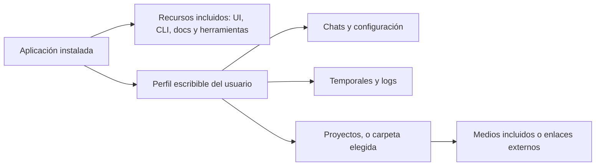

# Auditoría de instalación, estabilidad y rendimiento — 11/10/2026

Se corrigieron fallos reproducibles de caché, decodificación, export, importación de skills y preparación de recursos. Los chequeos de tipos de todos los workspaces pasan. La suite principal pasa 849 pruebas en 143 archivos; publicación/memoria y distribución agregan otras 34: **883 pruebas aprobadas**.

**No se generó ningún instalador.** Tampoco se ejecutaron Forge, `package`, `make`, `publish`, staging de recursos, Cargo ni descargas de runtimes. Se respetó el límite de espacio de F. La única compilación para activar cambios fue `build:main`, que reemplaza el bundle de desarrollo existente.

## Cobertura y método

Inventario inicial: **1.148 archivos públicos**, con 213 nombres correspondientes a pruebas. El [inventario de rutas](../output/audit/source-inventory-2026-10-11.json) permite contrastar la cobertura. Las áreas principales fueron:

| Área | Archivos en el inventario inicial | Circuitos revisados |
| --- | ---: | --- |
| Electron / escritorio | 139 | Arranque, IPC, perfiles, rutas, ventanas, recursos, importaciones y escrituras |
| Editor web | 588 | Motor, interacción, fuentes, preview, ciclo de vida y export |
| Agentes | 119 | Host, persistencia, proveedores, autenticación local y herramientas |
| Runtime | 111 | Audio/video, cachés, decodificación, recursos y mundo de edición |
| Encoder | 12 | Export con/sin audio, rangos, buffers y cancelación |
| DAPI | 34 | Comunicación con el editor y cola de revisión interna |
| Assets | 21 | Recursos y resolución de medios |

También se inspeccionaron scripts de desarrollo/distribución, CLI, paquetes auxiliares y configuración de pruebas. Se consultó Graphify como índice y se completó con búsquedas directas: su grafo cubre una selección del código, no todo el repositorio.

El inventario no equivale a una lectura manual de cada línea. Esta revisión combina inspección de los circuitos críticos, búsquedas transversales, pruebas de regresión, una medición de navegador y una comprobación del arranque real. No certifica que cualquier proyecto o máquina esté libre de errores.

Guías utilizadas: [rendimiento de Electron](https://www.electronjs.org/docs/latest/tutorial/performance) y [seguridad de Electron](https://www.electronjs.org/docs/latest/tutorial/security). Se priorizó evitar trabajo innecesario y liberar recursos conservando los límites de IPC y las tareas en segundo plano.

## Fallos corregidos

| Prioridad | Hallazgo y efecto | Cambio y evidencia |
| --- | --- | --- |
| Alta | El selector de caché de Electron rechazaba los puntos de su propia carpeta `43.1.1-UUID`. El siguiente arranque volvía a copiar el runtime. | [branded-electron.mjs](../scripts/branded-electron.mjs) valida versión y UUID sin permitir rutas arbitrarias. Siete pruebas y comprobación real: devuelve el ejecutable existente sin crear otra carpeta. Las copias anteriores se conservaron. |
| Alta | Audio, video, índices y sincronización usaban cachés globales con claves por ID. Podían retener recursos de proyectos cerrados y mezclar objetos de proyectos distintos con el mismo ID. | [WeakAsyncCache](../packages/runtime/src/utils/weak-async-cache.ts), claves por identidad del asset/track y referencias débiles. Se prueban deduplicación, reintento y limpieza por generación. La recuperación final depende de que los consumidores también suelten sus referencias. |
| Alta | Decodificaciones asíncronas podían terminar después de cerrar o pausar. Quedaban frames, iteradores o nodos de audio con un ciclo de vida incorrecto. | [Audio](../packages/runtime/src/media/audio.ts) y [video](../packages/runtime/src/media/video.ts) verifican generación/cierre después de los `await`. Se desconectan nodos terminados, se cierran frames y se libera el decoder al retirar el asset. Seis regresiones de ciclo de vida. |
| Alta | Exportar sin audio reservaba PCM para toda la duración y preparaba procesamiento de audio innecesario. | [Encoder](../packages/encoder/src/encoder.ts): contexto mínimo de un sample, mundo silencioso, sin bus ni decodificación de audio. Tres regresiones, incluido un export simulado de una hora y un rango vacío. |
| Media | La preview pausada recorría los sistemas del motor a unos 60 Hz. | [PreviewFramePacer](../apps/web/src/engine/preview-frame-pacer.ts): reposo a unos 20 Hz; interacción, reproducción, tickers y modo offline conservan la cadencia completa. Cuatro pruebas y medición del motor real. |
| Alta | Una importación de skill fallida dejaba una carpeta incompleta que bloqueaba el reintento. Se podía publicar `SKILL.md` antes de completar sus archivos. | [syka-agent-settings.ts](../apps/desktop/src/syka-agent-settings.ts): publica el marcador al final y elimina únicamente la carpeta nueva y verificada si falla. Se inyecta un fallo de copia, se confirma la conservación del origen y el reintento exitoso. |
| Media | Configuración MCP y guardado de skills usaban escrituras directas. | Se reutiliza el helper de escritura atómica existente, incluidos sus reintentos de reemplazo en Windows. |
| Alta | Staging podía reemplazar una carpeta válida antes de detectar entradas ausentes, o seguir un target no apropiado. | [staging-path.mjs](../scripts/lib/staging-path.mjs) rechaza traversal, archivos y enlaces/junctions, incluidos enlaces rotos. CLI y runtime comprueban entradas esenciales antes del borrado. Cinco pruebas del layout/target. No se ejecutó staging. |
| Alta | La preparación de distribución no contrastaba todos los recursos usados al arrancar o procesar medios. | Nuevo [preflight de distribución](../scripts/check-distribution.mjs), conectado antes de Forge. Detecta páginas, wrappers, módulos externos, runner, ONNX, esbuild nativo y binarios Windows/arquitectura. La prueba rechaza dependencias que resuelvan fuera del runtime. |
| Media | El cargador del estilo nativo de Mac podía impedir el arranque si el addon no cargaba. | [native-window-style.ts](../apps/desktop/src/native-window-style.ts): vuelve al estilo de ventana del sistema con diagnóstico. Cinco pruebas simuladas; no constituye una ejecución en Mac. |
| Media | La ejecución de pruebas descubría copias generadas, documentación y suites de otro runner; algunas fixtures dependían del directorio de ejecución. | [vitest.config.ts](../vitest.config.ts) limita el descubrimiento al código fuente, separa los tests `node:test` y usa dos workers. Se corrigieron rutas de fixtures y mocks incompletos sin ocultar suites del código público. |

## Medición de la preview

Perfil objetivo elegido por el usuario: **16 GB de RAM, gráficos integrados y SSD**. Esta medición se hizo en la computadora actual, no en otra PC que demuestre ese mínimo.

Condiciones: Chrome 154.0.8037.98 instalado, misma máquina, motor real con una escena vacía, silenciosa y sin medios del usuario. Calentamiento de 2,2 segundos, reposo de 12 segundos y reproducción de 2 segundos. No se descargó un navegador.

| Métrica | Antes | Después, comprobación final |
| --- | ---: | ---: |
| Recorridos del motor en reposo | 59,83/s | 19,92/s |
| Tiempo de tareas del renderer en 12 s | 0,253 s | 0,199 s |
| Cadencia al reproducir | 59,49/s | 59,48/s |
| Cadencia con una animación/ticker activo | Sin medición inicial | 60,00/s |
| Latencia del evento de puntero al siguiente recorrido | 5,7 ms | 7,3 ms |
| Heap JavaScript | 7,42 MiB | 7,46 MiB |
| Motor detenido después de `dispose()` | Sí | Sí |

La comprobación final reduce alrededor de **21 % el tiempo de tareas de esa fixture** y dos tercios de los recorridos en reposo. Las mediciones breves varían; no son un porcentaje de mejora de toda la aplicación. El heap de esta fixture no demuestra una reducción de RAM total. Faltan mediciones con medios reales y hardware del perfil objetivo.

Evidencia: [antes](../output/playwright/engine-performance-before.json), [después](../output/playwright/engine-performance-after.json) y [script reproducible](../scripts/qa-engine-performance.mjs).

El export sin audio elimina una asignación independiente de esa medición: una hora estéreo a 48 kHz implicaba alrededor de **1,38 GB de PCM**. Ahora se reserva solamente un sample para ese contexto. El export con audio conserva la implementación actual de PCM completo; ver pendientes.

## Rutas y preparación para otra computadora

No se encontraron dependencias activas del código público que exijan la unidad D, la F o el nombre de usuario del desarrollador. Los fixtures y ejemplos no se tomaron como rutas de producción. **Los proyectos existentes sí pueden enlazar medios mediante rutas absolutas**: copiar el proyecto sin esos medios no lo vuelve portátil. No se inspeccionaron ni migraron videos personales.

El runtime distribuido se calcula desde el perfil del usuario y los recursos de instalación. `SYKA_RUNTIME_ROOT` exige una ruta absoluta; `SYKA_MEDIA_ROOT` selecciona el directorio de proyectos. El modo de desarrollo conserva su runtime local actual. No se cambiaron carpetas personales ni credenciales.

El worker de recorte puede ejecutar su runner con Electron en modo Node; no se agregó una dependencia obligatoria de un Node global para ese worker. Las herramientas y proveedores opcionales siguen necesitando sus dependencias y autenticación propias. Muse permanece retirado; no se volvió a conectar.

## Estado de distribución: incompleto, a propósito sin regenerar

El preflight actual termina con código 1. La carpeta preparada anteriormente tiene los bundles, UI, CLI y documentos, pero **no incluye todo el runtime requerido**: faltan dependencias del runner de recorte, ONNX y sus DLLs, FFmpeg/FFprobe, grabador y avisos correspondientes. Esbuild nativo sí está presente.

Esto no es un fallo nuevo del arranque de desarrollo: distingue la máquina del desarrollador de lo que realmente llevaría una distribución. La verificación evita que una preparación incompleta pase a Forge sin aviso. [Resultado exacto](../output/playwright/distribution-preparation-2026-10-11.json).

Se dejó la reparación del proceso en código. **La regeneración de esos recursos queda pendiente por falta de espacio en F y por la instrucción de no preparar todavía el instalador.** No se ejecutaron comandos de staging ni se copiaron runtimes nuevos.

## Validación realizada

| Comprobación | Resultado |
| --- | --- |
| `npm run check --workspaces --if-present` | Aprobado, todos los workspaces con check |
| `npm test -- --reporter=dot` | 849 pruebas, 143 archivos, aprobadas |
| `npm run test:content` | 22 pruebas aprobadas |
| `npm run test:distribution` | 12 pruebas aprobadas |
| `npm run build:main --workspace=@diffusionstudio/desktop` | Bundle principal compilado; no empaquetado |
| Lint de los archivos web modificados | Aprobado, cuatro archivos; no se reescribieron otros cambios del repositorio |
| UI de producción y binarios nativos | No regenerados por espacio; la sesión de desarrollo carga la UI desde fuente |
| Medición del motor en navegador | Reposo, reproducción, ticker, puntero y cierre verificados |
| Arranque real de Electron | UI visible, bridge nativo y endpoint de agentes disponibles; captura inspeccionada |
| Estado de chats antes de cerrar la sesión de QA | 55 idle; ninguno running |
| Reutilización de Electron | Ejecutable de caché devuelto; listado de carpetas sin cambios |
| `npm run check:distribution` | Incompleto por los recursos indicados; resultado conservado |
| Instalador, staging, firma, publicación | No ejecutados |

La [captura de arranque](../output/playwright/syka-audit-startup-2026-10-11.png) muestra el editor restaurado por la aplicación, sin enviar mensajes ni exportar un proyecto. El endpoint disponible no equivale a una tarea de cada proveedor completada: no se hicieron llamadas pagas ni nuevos logins.

## Pendientes concretos

1. **Otra PC Windows:** validar importación de medios, codecs, micrófono, grabación, permisos y funcionamiento fuera del entorno de desarrollo. No hay instalador construido para esa prueba.
2. **Mac real:** compilar/ejecutar en Apple Silicon e Intel y verificar permisos, dependencias de medios, firma y notarización. El fallback del estilo y las pruebas estáticas no prueban un port completo.
3. **Exports y sincronización de audio muy largos:** el export con audio todavía crea PCM de toda la duración, y la sincronización puede cargar mucho material. Hace falta procesar por bloques antes de afirmar soporte cómodo para videos de varias horas en 16 GB.
4. **Proyectos complejos con muchos videos:** perfilar memoria total, GPU y decoders con material real. Las cachés débiles no son un presupuesto global de memoria ni fuerzan la recolección de basura.
5. **Muchos proyectos trabajando toda la noche:** la cola interna ya evita una preview pesada permanente por proyecto y sus pruebas pasan. Falta una prueba prolongada con agentes reales, reconexiones y suspensión/reanudación. No se forzó throttling global que pudiera afectar esas tareas.
6. **Staging completamente transaccional:** los nuevos chequeos preservan la preparación anterior si faltan entradas esenciales. Un fallo posterior de instalación/copia aún puede dejar la carpeta de staging incompleta; el preflight lo detecta. Conviene preparar en una carpeta temporal y reemplazar al terminar cuando se retome distribución.
7. **Edición simultánea de una misma skill:** el guardado es atómico, pero la lectura de revisión y el guardado no están serializados por skill. Dos editores que usen la misma revisión pueden producir un último guardado ganador. Es un riesgo de concurrencia pendiente, no una corrupción de archivo demostrada aquí.

Procedimiento y requisitos: [preparación para instalación](INSTALLATION_PREPARATION.md). Encargo reformulado: [prompt de auditoría](INSTALLATION_PERFORMANCE_AUDIT_PROMPT.md).
