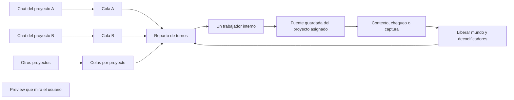

# Preview interna con cola por proyecto

Implementación: 10/10/2026. Resuelve la dependencia entre la revisión de un
agente y el proyecto que el usuario está mostrando. Las ediciones de archivos
pueden avanzar en paralelo; las herramientas del renderer se ejecutan por
turnos en un único trabajador interno. No se crea una preview residente por
proyecto y no se cambia la pantalla visible para revisar otro proyecto.

## Aislamiento

- El host asigna el ID y la carpeta del proyecto al endpoint MCP de cada chat.
  El destino queda fijado al inicializar la sesión; cambiar los parámetros de
  una URL posterior no lo redirige. Los comandos CLI del agente heredan ese
  mismo endpoint mediante `SYKA_PROJECT_MCP_URL`.
- Se comprueba que la carpeta todavía pertenezca al ID asignado. Una sesión
  interna solo puede abrir su propio proyecto. Un fallo no usa el proyecto
  visible como sustituto.
- El renderer visible se selecciona explícitamente. Una ventana interna,
  flotante o de notificación no puede convertirse accidentalmente en el destino
  de las herramientas habituales.
- Una respuesta IPC solo se acepta desde el renderer y frame que recibieron
  esa llamada. Un crash o una recarga falla las llamadas de esa ventana.
- La transferencia nativa de archivos carga el input del renderer solicitante,
  incluyendo videos en la preview interna.

## Cola y recursos

| Decisión | Comportamiento |
| --- | --- |
| Concurrencia de revisión | Un ejecutor por instancia de Syka, para cualquier cantidad admitida de proyectos. |
| Reparto | Round robin por proyecto, conservando el orden dentro de cada proyecto. Una ráfaga de A no acapara todos los turnos. |
| Espera | Hasta 512 solicitudes pendientes en total y 32 por proyecto. Solo se guardan argumentos y metadatos. |
| Límite de espera | 15 minutos; la llamada devuelve un error recuperable si expira. El agente recibe instrucciones de reintentar sin pedir un cambio de pantalla. |
| Ejecución | 2 minutos normalmente; captura, transcripción y escucha mantienen 10 minutos; segmentación mantiene 60 minutos. Los trabajos largos ocupan el trabajador hasta terminar: conviene pedir segmentos acotados. |
| Inicio | Ventana oculta creada al primer trabajo, con un handshake que confirma que sus herramientas están listas. |
| Página | Entrada separada del editor: no monta chat, timeline, router ni watchers del proyecto. |
| Playback | No arranca el loop de reproducción ni crea un AudioContext de salida. Captura usa el mismo motor offline que el editor. |
| Entre trabajos | Se drenan las escrituras, se liberan decodificadores, montaje, biblioteca, canvas y mundo. No quedan mundos por proyecto en espera. |
| Inactividad | El renderer se cierra tras 60 segundos sin trabajos. También se recicla cada 48 trabajos exitosos para acotar sus cachés. |
| Cancelación o fallo | Se destruye el trabajador antes de liberar el turno. Si esa destrucción falla, la cola se cierra: no inicia un segundo ejecutor sobre uno todavía activo. |

La justicia del reparto se aplica entre trabajos, sin cortar una captura o un
procesamiento a mitad de camino para dar un turno a otro proyecto. Los límites
de cola devuelven errores explícitos; no descartan solicitudes en silencio.
La cola vive en memoria: cerrar Syka cancela los trabajos de esa instancia.
No es un scheduler que siga trabajando con la aplicación cerrada.

## Fuente, medios y exportación

La revisión compila la fuente guardada y utiliza ese mismo bundle para sus
capturas. Una huella de la fuente se compara antes/después de compilar y al
terminar la revisión. Si cambia, la revisión devuelve un error; el agente debe
guardar y repetirla antes de afirmar que pasó. La compilación puede asignar
IDs durables: se admite repetir el intento hasta tres veces para estabilizarla.

Esta huella es independiente del historial de deshacer: un conflicto del
historial no impide leer y revisar una edición externa ni provoca un reset del
historial. Incluye archivos de autoría y configuración; tiene límites de 2048
archivos, 32 MiB, 8192 entradas y 24 niveles. No recorre medios, cachés,
node_modules, evidencia ni carpetas ocultas; admite los archivos Babel
habituales de la raíz. `assets.yml` se excluye porque el sondeo de la biblioteca
actualiza esa metadata. La huella no prueba inmutabilidad de los bytes de
medios externos ni de dependencias fuera de ese alcance.

Se reutilizan transcripciones automáticas ya guardadas. Revisar una composición
no inicia generación o transcripción implícita. Una segmentación solicitada
explícitamente debe terminar antes de liberar su biblioteca interna, para no
dejar tareas escribiendo sobre un mundo descartado.

La exportación continúa siendo una acción del usuario. Las revisiones internas
no exportan un video ni capturan la interfaz del usuario. Las preguntas
creativas y la aprobación de decisiones siguen existiendo; lo que desaparece
es la necesidad técnica de pedir que se reabra un proyecto para revisarlo.

## Verificación realizada

- 50 proyectos más una ráfaga de solicitudes de un proyecto: un solo ejecutor,
  reparto de turnos, cancelaciones, límites, expiración y recuperación.
- 19 tests del puente desktop y 32 del host/proveedor simulado, todos correctos.
  Se probaron identidad inmutable, propiedad de respuestas IPC y aislamiento de
  un crash; también que un reset fallido no permita ejecutar el próximo trabajo.
- Electron real, servidor MCP real y motor real en una instancia aislada:
  10 proyectos distintos pidieron contexto, chequeo y captura en paralelo.
  Los píxeles de cada imagen coincidieron con su proyecto, con máximo un
  trabajador. La preview visible de prueba conservó su URL.
- La misma batería pasó con Vite y con la página compilada cargada por `file:`.
  Incluye pintura HTML oculta, decodificación de video, un cambio de fuente
  durante la captura y revisión posterior, error de compilación seguido de un
  proyecto sano, destino incorrecto, apertura de otra carpeta y 20 revisiones
  repetidas. Los canvas se liberaron y el renderer inactivo se cerró.
- La batería también pasó usando los recursos staged de `apps/desktop/web`.
  Luego se comprobó el puente completo en el Syka abierto: dos proyectos de
  QA pidieron contexto y captura en paralelo, cada destino fue correcto y
  produjo un PNG de 1280×720. El catálogo del chat no ofrecía exportación.
- TypeScript de desktop, web, CLI, host y configuración de build: correcto.
  Builds de main, preload, host, CLI y páginas web: correctos.

Evidencia local: `.runtime/preview-queue/verification.json`,
`verification-build.json`, `verification-stage.json`,
`verification-native.json`, `captures/` y `native-captures/`. El harness de Electron está en
`.runtime/preview-queue/launch.mjs` y `main.ts`. Son proyectos de prueba; no se
abrieron ni modificaron los proyectos personales del usuario, no se llamó a
proveedores pagos y no se reinició su aplicación para probar.

Falta validar una sesión nocturna larga con agentes reales y material del
usuario. Estas pruebas no miden un consumo máximo garantizado de RAM/CPU,
no prueban macOS ni eliminan la posibilidad de conflictos si varias personas
editan el mismo archivo o manifiesto a la vez. La cola aísla proyectos y
serializa sus herramientas internas; no sustituye todo el control de edición.

## Activación y prueba del usuario

Los cambios de main/host se cargan al iniciar esos procesos: escribir un build
nuevo no cambia una instancia que ya los tenía cargados. Esta tarea no detuvo
ni reinició los turnos del usuario. Durante el cierre se observó una nueva
instancia abierta (PID 3332) y se confirmó allí la cola con dos proyectos QA,
sin cambiar el proyecto visible ni ejecutar agentes pagos. Una sesión de
proveedor que todavía conserve el endpoint anterior necesita renovar su
conexión al host actualizado en un reinicio normal, después de terminar su turno.

Para probar el circuito con agentes reales:

1. Abrir dos o más proyectos con contenido distinguible. Pedir a cada agente
   una edición y su revisión mediante `check/capture`.
2. Dejar visible otro proyecto o el inicio. Los agentes deberían recibir sus
   propias capturas y continuar sin pedir que se cambie de proyecto.
3. Probar un proyecto con un error de fuente y uno sano. El error debe aparecer
   en el primero; el segundo debe poder terminar su revisión.
4. Confirmar que no se inició una exportación automática. Las capturas de
   revisión son imágenes de trabajo, no el export final del video.

El alcance del grafo local se amplió al puente DAPI, las rutas de proyectos y
el endpoint del CLI para que estas conexiones puedan consultarse en tareas
futuras. El actualizador local existente conserva su funcionamiento automático;
el índice quedó vigente con 216 archivos y encontró `InternalPreviewWorker`.
