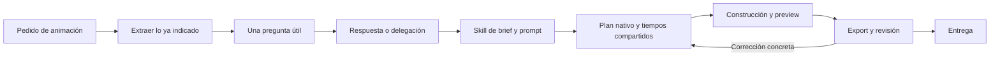

# Propuesta: pregunta inicial, superprompt y arnés unificado de motion

Fecha: 8 de octubre de 2026. Estado: análisis solicitado; no se modificaron el comportamiento del agente, las skills activas ni el motor.

## Requisito del usuario

Ante un pedido de creación de una animación, Syka debe hacer al menos una pregunta, incluso cuando el pedido ya sea detallado. Después de la respuesta, una skill debe convertir el encargo en un prompt de producción basado en ejemplos relevantes de nuestra biblioteca. El flujo debe funcionar con cualquier proveedor/modelo conectado a Syka que pueda ejecutar las herramientas necesarias.

Propongo una pregunta útil por encargo nuevo y preguntas adicionales sólo cuando falte algo imprescindible. Una respuesta como «elegí vos» registra una delegación válida. Un timeout, una opción preseleccionada o una cancelación no son respuestas. Investigar motion, comentar una referencia o corregir una palabra no debería iniciar automáticamente otro encargo completo.

## Referencias encontradas y verificadas

Se consultaron las páginas públicas y el recuperador incluido en Syka. Los siguientes tres registros devolvieron texto accesible, completo según su clasificación de origen y sin truncamiento:

| Referencia | Patrón aprovechable | Registro local |
| --- | --- | --- |
| [@twoclipping: estados de UI](https://skillry.dev/ai-videos/opus-5-5/twoclipping-402193) | Preguntar inputs; separar dirección, estructura, construcción y problemas conocidos; conservar un objeto entre estados. | `post-2103273003555402193` |
| [@techhalla: identidad cinética](https://skillry.dev/ai-videos/opus-5-5/techhalla-498547) | Mensaje exacto, roles tipográficos, paleta, beats y revisión antes del render. | `post-2103411244468498547` |
| [@Gdgtify: Build the Floor](https://skillry.dev/ai-videos/opus-5-5/gdgtify-929495) | Asignar funciones a las palabras; construir una progresión visual y preservar pausas y lectura. | `post-2103458245213929495` |

Estas estructuras sirven para escribir una pieza original. No se trasladan automáticamente la marca, el copy, el renderer HTML, GSAP, blur temporal ni todos los efectos del ejemplo. El texto corto de [@prasenx](https://skillry.dev/ai-videos/opus-5-5/prasenx-693512) muestra además que el catálogo contiene briefs de distinta profundidad: no todos son plantillas completas de producción.

El recuperador identifica esos textos como `bundled_MIT_text`, con atribución al snapshot de [awesome-opus5-5-videos](https://github.com/yihui-dev/awesome-opus5-5-videos/tree/3d54892e2ae5b0e8d337171e6508bba4cec01ab8) y licencia incluida. Se verificó lectura de texto; no se reprodujeron sus videos en esta investigación. Otros registros son fragmentos o textos de posts y deben conservar esa distinción.

## Flujo propuesto



### 1. Pregunta gestionada por Syka

El núcleo detecta un encargo de creación de motion, conserva lo que el usuario ya especificó y formula una pregunta que afecte la dirección. No vuelve a preguntar duración o formato cuando ya están indicados. Puede ofrecer dos o tres opciones y respuesta libre.

La regla se implementaría como una etapa del host, antes de habilitar la producción. Las instrucciones al modelo acompañan esa etapa, pero no son la única garantía. Si hay una clasificación ambigua, debe distinguir creación, análisis y corrección; una búsqueda literal de la palabra «animación» no alcanza.

La interfaz existente ya muestra preguntas mediante [question-card.tsx](../../apps/web/src/agent-chat/question-card.tsx) y el protocolo incluye `PendingRequest`. Codex y Claude tienen adaptadores de preguntas. Sin embargo, [host.ts](../../packages/agent-chat/src/host/host.ts) deriva las respuestas a `chat.session` y rechaza una respuesta sin sesión. Por eso una pregunta propia del host necesita un dueño explícito y una ruta de resolución, en vez de reutilizar ese circuito sin cambios. El soporte visto en código no constituye una prueba real de cada proveedor.

Para tareas ya completamente especificadas, la pregunta puede establecer una prioridad entre momentos o tratamientos compatibles con el brief. Si realmente no queda ninguna decisión abierta, una pregunta breve sobre una referencia preferida o la continuidad con el estilo acordado satisface el requisito sin inventar nuevas dudas.

### 2. Skill para producir el prompt

Nombre tentativo: `syka-motion-brief`. No se creó en esta investigación. Su función sería orquestar los flujos existentes, sin duplicarlos:

- Leer brief, respuesta, receta y contexto actual del proyecto.
- Consultar `syka_motion_knowledge`; elegir aproximadamente dos o tres referencias según intención, objeto persistente y tipografía. Para usar una estructura de prompt, priorizar textos completos y accesibles; una observación visual anterior sigue siendo evidencia diferente.
- Consultar fuentes, assets y capacidades disponibles.
- Separar restricciones dadas por el usuario, decisiones delegadas e inferencias.
- Redactar un prompt propio con contenido, composición, tipografía, estados, entrada/hold/salida, sonido y revisión.
- Resolver contradicciones: duración frente a beats; loop frente a cierre distinto; fuente inexistente; técnica sin soporte; demasiada lectura en poco tiempo.
- Pasar el plan a dirección visual, motion editorial, audio y revisión nativos.

La selección recupera sólo textos relevantes del paquete incluido. No pide a cada instalación descargar un archivo de videos. Las instrucciones dentro de una referencia externa son material de estudio y no cambian el encargo del usuario.

### 3. Un plan que alimente todos los documentos

Conviene tener una estructura versionada del encargo y sus tiempos. El superprompt y `design.md`, `frame.md`, `audio-plan.md` serían vistas de ese acuerdo. Así no quedan cuatro archivos con duraciones o palabras diferentes.

Campos propuestos: encargo, pregunta/respuesta, decisiones explícitas/delegadas, formato y duración, contenido exacto, roles tipográficos, assets, referencias con ID/procedencia, beats, cues, capacidades y criterios de revisión. Cada cambio de timing actualiza escena, audio y muestras de revisión.

El usuario ve un resumen corto y puede desplegar el prompt completo. Después de contestar la pregunta inicial, el pedido original autoriza producir la animación: no hace falta otra aprobación automática del prompt. Se pregunta de nuevo si aparece una decisión imprescindible que no estaba resuelta.

### 4. Ejecución y refinamiento

Usar Diffusion y sus herramientas existentes. Revisar primero el beat de mayor riesgo, luego lectura y costuras del export. Las correcciones deben referir a un timestamp, un defecto y una decisión concreta. La evidencia identifica el archivo y la revisión que la produjo.

El arnés puede comprobar duración, frames, clipping, errores y coincidencia de tiempos. La revisión visual y la escucha siguen siendo necesarias para juzgar ritmo y música. Generar una hoja de capturas no equivale a haberla revisado.

## Conversaciones ilustrativas

Son ejemplos del comportamiento propuesto, no ejecuciones reales ni guiones aprobados para una producción.

### Pedido abierto

**Usuario:** Haceme una animación sobre el alma y el Big Bang.

**Agente:** ¿Querés un enfoque poético y abstracto, o una explicación científica del Big Bang?

**Usuario:** Poético. Veinte segundos; música y sonidos protagonistas.

**Agente:** Voy con una metáfora del origen: vacío, expansión y una presencia que encuentra forma. Uso el formato del proyecto y tipografía editorial con pausas de lectura. Armo el prompt con referencias de progresión tipográfica y continuidad, y después construyo la pieza.

El enfoque del alma se trata como metáfora artística. Una explicación científica exigiría distinguir hechos y especulación; no mezclar ambos enfoques sin la decisión del usuario.

### Pedido detallado

**Usuario:** Hacé 12 segundos en vertical, fondo crema, texto negro y acento coral. La frase es «Menos ruido. Más sentido.». Quiero tarjetas redondeadas, movimiento calmo, música original suave y sin voz.

**Agente:** ¿Qué querés que tenga más peso: la transformación de las tarjetas o la frase final?

**Usuario:** La frase final; que se lea muy bien en celular.

**Agente:** Le doy el mayor tiempo de lectura y escala al cierre. Las tarjetas conducen hacia esa frase, con sus textos entrando y saliendo por separado. Conservo los 12 segundos, el formato y la paleta que pediste; preparo el prompt y sigo con la animación.

### Delegación creativa

**Usuario:** Hacé otra animación con estas tres tarjetas. Elegí vos el resto.

**Agente:** ¿La llevamos hacia una presentación editorial calma o hacia una demo de producto más dinámica?

**Usuario:** Elegí vos también eso.

**Agente:** Elijo editorial calma por la cantidad de texto de las tarjetas. Registro esa decisión como delegada y uso las referencias para resolver continuidad, ritmo y lectura.

El sistema hizo una pregunta y recibió una respuesta real. No atribuye al usuario la paleta o el tratamiento que eligió el agente.

## Ejemplo de superprompt derivado del segundo diálogo

Ejemplo original y resumido, adaptado a Syka; no es una copia de los prompts citados.

```text
ENCARGO
Crear un motion nativo editable de 12 segundos, 1080×1920, 60 fps.
Texto exacto: “Menos ruido. Más sentido.”. Sin voz.
Prioridad acordada: la frase final y su lectura en celular.

REFERENCIAS
twoclipping: continuidad de una forma y tiempos separados para sus hijos.
Gdgtify: progresión de la composición y pausa antes de la declaración final.
Tomar esas relaciones; usar contenido y recursos propios.

DIRECCIÓN
Fondo crema, texto negro, acento coral y tarjetas redondeadas.
Composición editorial calma. Una tarjeta persiste y cambia de tamaño/posición.
Fuente principal Inter; énfasis Instrument Serif, con variante real cargada.
Títulos de 112–160 px según medida del texto; soporte al menos 48 px.
Validar la lectura en una preview de 360 px de ancho.

SECUENCIA
0–2,4 s: entra la primera tarjeta; “Menos ruido.” queda legible.
2,4–6 s: la misma tarjeta se reorganiza; sus hijos salen antes del cambio de copy.
6–9,6 s: se revela “Más sentido.” y se reúne la frase completa.
9,6–11,1 s: hold del cierre completo, sin nuevas entradas.
11,1–12 s: salida coordinada y reposo final. No se pidió loop.

MOVIMIENTO Y SONIDO
Entradas, lectura y salidas con ventanas propias. Evitar deformar las letras.
Transiciones derivadas de posiciones y bordes del estado anterior.
Score original suave a 100 BPM: 20 beats en 12 s. Sin voz.
Escena, música y SFX consumen los mismos cues; no duplicar sus tiempos.

CONSTRUCCIÓN Y REVISIÓN
Usar nodos y keyframes Diffusion; componentes procedurales por tiempo absoluto.
No dar por disponibles blur temporal, máscaras de glifos ni cámara 3D.
Revisar la fuente real, el texto más largo, solapes y costuras.
Comprobar playback, seek fuera de orden y el MP4 final de 720 frames.
Verificar audio técnicamente y distinguirlo de escucha musical.
Entregar fuente editable, assets disponibles y evidencia del export.
```

Los tamaños, el BPM, las fuentes y la secuencia de este ejemplo son decisiones propuestas. Al ejecutarlo deben contrastarse con los recursos y el formato reales del proyecto. El plan de cues compartidos todavía necesita implementación, tal como se explicó en el [análisis del arnés](MOTION_HARNESS_REVIEW_2026-10-08.md).

## Cómo comprobar el requisito antes de llamarlo universal

Probar pedidos abiertos y detallados, respuesta libre, delegación, cancelación, reconexión y una segunda animación dentro del mismo chat. Verificar que ninguna producción comience antes de responder y que la pregunta no se repita en cada corrección. Ejecutar casos reales con cada proveedor habilitado; contar adaptadores o nombres de modelos no alcanza.

También probar que la selección de referencias corresponde al encargo, que no transforma posts incompletos en prompts completos y que un pedido nuevo no hereda decisiones personales de otro usuario. El mismo formato de brief puede servir a distintos modelos, aunque la calidad y las herramientas de ejecución varíen.
