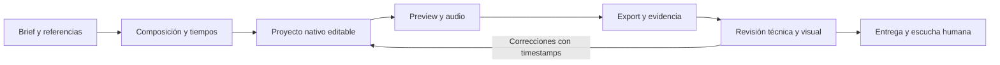

# Arnés de motion y cámara 3D: análisis para Syka

Fecha: 8 de octubre de 2026. Estado: investigación y propuesta; los dos repos externos no se instalaron ni se integraron en el motor. Se mantuvo Diffusion como renderer nativo.

El motion anterior ya se terminó y se subió por separado: [El silencio también habla · 12 segundos](https://drive.google.com/file/d/1woMB5kzq7nuaNQFl7BsydmYreUf20XbG/view). Su validación está en [el registro de QA](../qa/TEXT_PREVIEWS_MOTION_2026-10-08.md).

## Qué significa «arnés»

Un arnés es el sistema que permite que un modelo trabaje como agente: recibe contexto, conecta herramientas, conserva resultados y organiza la ejecución. Un arnés de evaluación ejecuta casos y comprueba sus resultados. Ambas cosas pueden convivir en un flujo de motion, pero generar capturas o pasar un test de codecs no demuestra calidad visual o musical. [Definiciones de Anthropic](https://www.anthropic.com/engineering/demystifying-evals-for-ai-agents).

Para Syka, el flujo útil sería:

Una skill aporta instrucciones y ejemplos a ese flujo. El arnés además tiene herramientas, estado y verificación. Mejorar esa combinación no modifica los pesos del modelo.

## Promo Video Generator

Versión revisada: [`9cb936aadce7f06015ea9aaef630483fda88cc34`](https://github.com/visser23/promo-video-generator/tree/9cb936aadce7f06015ea9aaef630483fda88cc34). Licencia del código: [MIT](https://github.com/visser23/promo-video-generator/blob/9cb936aadce7f06015ea9aaef630483fda88cc34/LICENSE).

Es un toolkit para un agente de programación existente. El agente escribe escenas HTML/JS, revisa imágenes, genera audio y usa Chrome/FFmpeg para producir el MP4. El repo no contiene un orquestador autónomo que llame a un modelo. En el árbol publicado revisado no encontré pesos, checkpoints ni un proceso de entrenamiento. [README](https://github.com/visser23/promo-video-generator/blob/9cb936aadce7f06015ea9aaef630483fda88cc34/README.md).

### Documentos que conviene aprovechar

| Archivo | Aporte para Syka |
| --- | --- |
| [AGENTS.md](https://github.com/visser23/promo-video-generator/blob/9cb936aadce7f06015ea9aaef630483fda88cc34/AGENTS.md) | Proceso desde storyboard y assets reales hasta revisión del export. |
| [PROMPTING.md](https://github.com/visser23/promo-video-generator/blob/9cb936aadce7f06015ea9aaef630483fda88cc34/docs/PROMPTING.md) | Brief con público, una idea central, beats, referencias, sonido y correcciones por tiempo. |
| [LESSONS.md](https://github.com/visser23/promo-video-generator/blob/9cb936aadce7f06015ea9aaef630483fda88cc34/docs/LESSONS.md) | Problemas concretos de fuentes, rasterización, visibilidad, color, acumulación temporal y procesos. |
| [API.md](https://github.com/visser23/promo-video-generator/blob/9cb936aadce7f06015ea9aaef630483fda88cc34/docs/API.md) | Contrato del reloj, cues y primitivas de movimiento. |

Sus recetas de impacto, shake y golpes de sonido sirven para ciertas promos. No deberían convertirse en reglas obligatorias para una pieza calma. Las recomendaciones específicas del DOM y Chrome tampoco se trasladan automáticamente al canvas nativo de Syka.

### Capacidades concretas

**Tiempos compartidos.** Un `cues.json` alimenta tanto la imagen como el sonido. Cambiar un evento cambia sus dos partes. En nuestra prueba de 12 segundos, los tiempos de escena y de audio todavía están escritos en archivos distintos; centralizarlos sería una mejora concreta. [Plantilla de cues](https://github.com/visser23/promo-video-generator/blob/9cb936aadce7f06015ea9aaef630483fda88cc34/templates/starter/cues.json), [escena](https://github.com/visser23/promo-video-generator/blob/9cb936aadce7f06015ea9aaef630483fda88cc34/templates/starter/scene.js), [sonido](https://github.com/visser23/promo-video-generator/blob/9cb936aadce7f06015ea9aaef630483fda88cc34/templates/starter/sound.py).

**Movimiento por tiempo absoluto.** `seek(t)` calcula el estado de la escena para un instante, sin depender de cuánto tiempo estuvo reproduciéndose. Eso permite buscar frames y volver a renderizar. Syka ya tiene ese principio con keyframes y `useTicker`; conviene reforzarlo en componentes procedurales. [motion.js](https://github.com/visser23/promo-video-generator/blob/9cb936aadce7f06015ea9aaef630483fda88cc34/lib/motion.js).

**Motion blur temporal.** El renderer toma varios subframes alrededor de cada frame; el build los promedia. Usa cuatro muestras por defecto y shutter de medio frame. Es una implementación real de acumulación temporal, con mayor costo de render. No es una mejora ya disponible en nuestro export nativo ni una prueba de que toda animación queda mejor al activarla. [render.js](https://github.com/visser23/promo-video-generator/blob/9cb936aadce7f06015ea9aaef630483fda88cc34/tools/render.js), [build.sh](https://github.com/visser23/promo-video-generator/blob/9cb936aadce7f06015ea9aaef630483fda88cc34/tools/build.sh).

**Audio procedural.** Ofrece percusión, instrumentos y efectos sintetizados con NumPy/SciPy a 44,1 kHz. Syka ya cuenta con generación local de stems a 48 kHz; tiene más valor compartir eventos que incorporar un segundo stack de audio. Normalizar RMS y limitar picos no equivale a medir LUFS ni a escuchar la música. [synth.py](https://github.com/visser23/promo-video-generator/blob/9cb936aadce7f06015ea9aaef630483fda88cc34/lib/synth.py).

**Checks de export.** Sus smoke tests comprueban imágenes, determinismo de una secuencia repetida, cantidad de frames, WAV y codecs/duración de una escena corta. No evalúan legibilidad, composición, reproducción normal ni gusto musical. [smoke.js](https://github.com/visser23/promo-video-generator/blob/9cb936aadce7f06015ea9aaef630483fda88cc34/tests/smoke.js).

### Detalles que impiden copiarlo sin revisar

- Su API describe el overshoot de `spring()` como aproximadamente 10%. Evalué la función publicada, aislada en Node, con sus valores por defecto: el máximo muestreado fue **1,25399 a 0,1955 s**, aproximadamente 25,4%. La amplitud debe elegirse según el elemento y su margen disponible.
- Un RNG con seed sigue teniendo estado. Si se consume dentro de `seek(t)`, el resultado puede depender del orden de visitas; hay que precalcular los valores o derivarlos del tiempo/identificador.
- El render usa Chrome y el build usa Bash, Python y FFmpeg. No es un paquete nativo listo para nuestras instalaciones Windows.
- Los tests no cubren toda la recuperación de procesos ni todos los errores de un render incompleto. Una adaptación necesita cancelar y limpiar solamente procesos y archivos propios.

Se leyó documentación y código y se hizo la evaluación matemática mencionada. No se instaló el repo, no se ejecutó su suite completa ni se midió su rendimiento; tampoco se revisó visualmente su video de ejemplo.

## Camera 3D Captions

Versión revisada: [`ba7a0bb6d3567d124c51f6074625043bfe0b32eb`](https://github.com/heygen-com/hyperframes-community-skills/tree/ba7a0bb6d3567d124c51f6074625043bfe0b32eb/skills/camera-3d-captions). Licencia del repositorio: [Apache-2.0](https://github.com/heygen-com/hyperframes-community-skills/blob/ba7a0bb6d3567d124c51f6074625043bfe0b32eb/LICENSE).

Es una skill especializada en tipografía para planos de una persona hablando con cámara estable. Su aporte combina proyección de profundidad, parallax, movimiento de cámara, foco y texto en anillos. Se revisaron su [SKILL.md](https://github.com/heygen-com/hyperframes-community-skills/blob/ba7a0bb6d3567d124c51f6074625043bfe0b32eb/skills/camera-3d-captions/SKILL.md), las [recetas](https://github.com/heygen-com/hyperframes-community-skills/blob/ba7a0bb6d3567d124c51f6074625043bfe0b32eb/skills/camera-3d-captions/references/recipes.md) y el [cálculo de cámara](https://github.com/heygen-com/hyperframes-community-skills/blob/ba7a0bb6d3567d124c51f6074625043bfe0b32eb/skills/camera-3d-captions/assets/kit/cam3d.js).

### Qué podemos adaptar

| Técnica | Adaptación propuesta al motor nativo |
| --- | --- |
| Palabras en varios planos | Proyectar posición/escala mediante tiempo absoluto; mantener texto editable donde alcance la API. |
| Parallax y rack focus | Compartir una cámara entre grupos y limitar blur según tamaño y lectura. |
| Anillos de texto | Usar avance real de glifos, orientación tangencial y separación recalculada durante la cámara. Puede requerir un surface especializado. |
| Texto detrás de la persona | Fondo, texto posterior, video recortado por alpha y texto frontal, con reloj y transformaciones idénticos. |
| Revisión de límites | Verificar clipping, lectura y superposición en momentos de entrada, hold, movimiento y salida. |

Syka dispone de `useTicker`, superficies pintadas y máscaras de alpha por frames. Eso da una vía técnica de adaptación; no demuestra que ya tengamos matting de personas con calidad suficiente. El recorte de pelo, bordes y movimiento requiere una prueba con footage real. Un tracker de objetos no equivale por sí solo a un matte limpio de una persona.

El upstream depende de HyperFrames, GSAP y herramientas auxiliares; su preparación de máscaras puede descargar un modelo de aproximadamente 170 MB. No hace falta incorporar esas dependencias para reutilizar sus principios de proyección. El peso de ese modelo pertenece al recorte de personas, no a un entrenamiento de motion incluido en la skill.

Dos decisiones necesitan adaptación: su tipografía puede actualizarse a 15 fps por intención estética, lo que no responde automáticamente a nuestra búsqueda de fluidez; y anticipar palabras respecto de la voz debe ser opcional, sin modificar el reloj base de los subtítulos. El grano y los efectos aleatorios deben reproducirse al buscar el mismo instante.

El DOM y las transformaciones CSS del ejemplo no se deberían copiar tal cual: nuestra captura de HTML tiene limitaciones conocidas. Conviene usar entidades nativas y, para proyección especializada, [surface-paint](../reference/jsx/surface-paint.md). La oclusión usaría el contrato real de máscaras de [types.ts](../../packages/jsx/src/types.ts).

## Qué ya existe en Syka

El código actual ya contiene la conexión de proveedores y herramientas en [harness.ts](../../packages/agent-chat/src/host/harness.ts), consulta de conocimiento incluido en [motion-knowledge.ts](../../packages/agent-chat/src/host/motion-knowledge.ts), recetas persistentes en [editing-recipe.ts](../../packages/agent-chat/src/host/editing-recipe.ts) y evidencia del export en [motion-review.ts](../../packages/agent-chat/src/host/motion-review.ts).

Por eso conviene ampliar ese sistema. La biblioteca portable distribuye reglas, estudios escritos, prompts con procedencia y componentes; los videos propios se mantienen como assets de cada proyecto. El agente recupera referencias relevantes sin exigir un archivo personal de cientos de videos en cada máquina.

## Prioridad propuesta y criterio de éxito

1. **Cues compartidos:** eventos con nombre, tiempo, duración y relaciones; escena, música, SFX y revisión consumen el mismo archivo. Validar que mover una entrada mueve su sonido y sus muestras de revisión sin duplicar números.
2. **Flujo de revisión:** brief → plan tipográfico/composición → preview → export → capturas de costuras y lectura a tamaño pequeño → correcciones. Cada evidencia debe identificar el export y la revisión que la produjo; un snapshot posterior no demuestra la procedencia de un MP4 viejo.
3. **Primitivas nativas:** entradas/salidas, holds, máscaras y cámara con parámetros medidos. Probar reproducción normal, seek en distinto orden, fuente real, edición y undo.
4. **Cámara 3D optativa:** comenzar con profundidad y parallax sin oclusión; probar anillos y después matte sobre footage real. Mantener sincronía de palabras y lectura como criterios.
5. **Blur temporal:** prototipo acotado y comparación de export con/sin blur. Medir costo, nitidez de texto, bordes, seek y coincidencia de duración antes de ampliar el renderer.

Para comprobar que mejora el resultado, usar briefs comparables de tipografía editorial, tarjetas, promo y subtítulos. Conservar modelo/esfuerzo equivalentes, comparar varias ejecuciones y revisar el video a velocidad normal. Los checks técnicos detectan errores; la valoración visual y la escucha determinan si la pieza funciona.

Estas prioridades son propuestas. Las mejoras de las muestras de texto y el motion de 12 segundos sí se realizaron y validaron; cues compartidos, cámara 3D y blur temporal no se implementaron en esta investigación.
